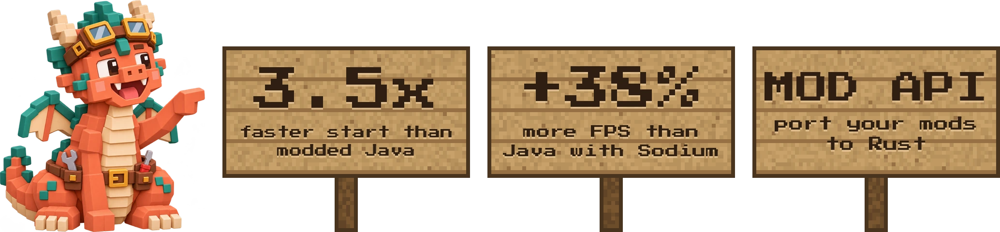

  

  <b>Horizon rebuilds Minecraft: Java Edition 26.3 from scratch in Rust: one native program, no Java.</b> 
  Vanilla's terrain, mobs, villagers and redstone in every dimension, and your saves open as they are.

  

  You need a Microsoft account that owns Minecraft: Java Edition. The <a href="https://playhorizon.dev/docs/install">install guide</a> has the steps.

  <a href="https://playhorizon.dev"><b>Website</b></a> ·
  <a href="https://playhorizon.dev/docs/"><b>Docs</b></a> ·
  <a href="https://discord.gg/playhorizon"><b>Discord</b></a>

  

  <b>See farther</b> · terrain up to 1,024 chunks away 
  <b>Play together</b> · vanilla and Horizon servers, LAN, or a code from a friend 
  <b>Built in</b> · HDR and controller support

  

  The title screen in about 3 seconds instead of 11, and 31 to 38 percent more frames per second. 
  A mod API in Rust: <a href="https://playhorizon.dev/mods">browse the mods</a> or <a href="https://playhorizon.dev/docs/make-a-mod">make your own</a>.

  Speed measured against Java Edition with Sodium, Lithium, FerriteCore and ImmediatelyFast on a Ryzen 7 9800X3D with an RTX 5080, across render distances. Other computers are on the <a href="https://playhorizon.dev/benchmarks">benchmarks page</a>.

<h2 align="center">Made by the Horizon Team</h2>

  
  
  
  
  
  

  <a href="https://github.com/kacpherek"><b>Kacper</b></a> ·
  <a href="https://github.com/Online5277"><b>Cosmic</b></a> ·
  <a href="https://github.com/levzzz5154"><b>levzzz</b></a> ·
  <a href="https://github.com/rdbtCVS"><b>rdbt</b></a> ·
  <a href="https://github.com/dezer-x"><b>Anthony S</b></a> ·
  <a href="https://github.com/ludovic111"><b>Ludovic Marie</b></a>, founder

  and everyone who has contributed  
  

  <a href="docs/native-client.md#run-from-a-checkout"><b>Build guide</b></a> ·
  <a href="CONTRIBUTING.md"><b>Contributing</b></a> ·
  <a href="GOVERNANCE.md"><b>Governance</b></a>

Horizon is released under the [MIT licence](LICENSE) for the project's original work; dependencies keep their own licences, see the [notices](THIRD_PARTY_NOTICES.md). Founded by [Ludovic Marie](https://lu4ovic.com) and built by the Horizon Team and [its contributors](https://github.com/horizon-rust/horizon/graphs/contributors). You can support it on [GitHub Sponsors](https://github.com/sponsors/ludovic111).

NOT AN OFFICIAL MINECRAFT PRODUCT. NOT APPROVED BY OR ASSOCIATED WITH MOJANG OR MICROSOFT. Minecraft is a trademark of Mojang Synergies AB; its code and assets belong to Mojang and Microsoft under the [Minecraft EULA](https://www.minecraft.net/en-us/eula).
